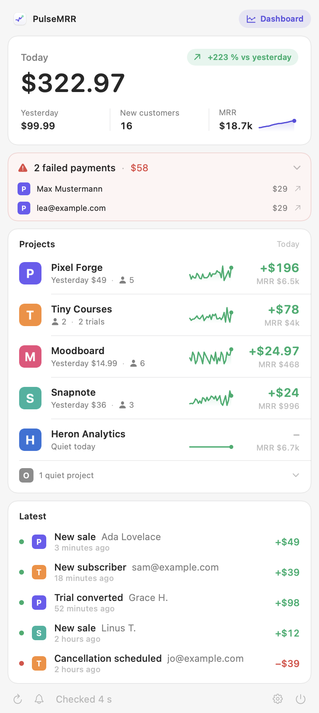
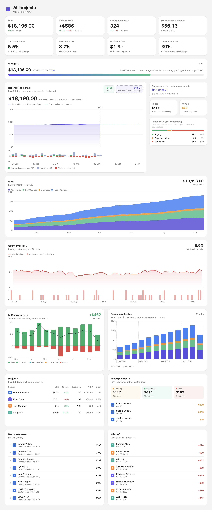
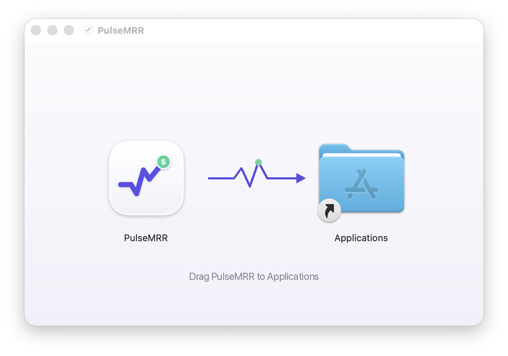

<p align="center"></p>

<h1 align="center">PulseMRR</h1>

<p align="center"><b>A native Mac notification for every Stripe sale.</b><br>
All your Stripe accounts in one menu bar app: sales, subscribers, cancellations, failed payments, today's takings and MRR.<br>
Free, open source, no server. Your keys never leave your Mac.</p>

<p align="center">
  <a href="https://github.com/benjaminb10/pulsemrr/releases/latest"><b>Download for macOS</b></a> ·
  <a href="https://encorescreen.com/support">Support the project ☕</a>
</p>

<p align="center">
  <picture>
    <source media="(prefers-color-scheme: dark)" srcset="docs/panel-dark.png">
    
  </picture>
</p>

## What it does

- **A notification for what matters**, each one switchable: new sale, new subscriber, new customer, trial started, trial converted, cancellation scheduled, subscription ended, failed payment, refund, dispute, payout. Money coming in plays a cash register sound. Notifications can stay on screen until you dismiss them.
- **Every Stripe account in one place.** Add as many as you run, each with its project's logo (taken from your Stripe branding or your website) or an emoji. Drag to reorder.
- **Today at a glance:** the day's takings, yesterday, today's new customers and your total MRR, with today's amount and new customers right in the menu bar if you want them.
- **Failed payments on one line.** Expand it to see who failed and open each one in Stripe.
- **One row per project:** today's takings, new customers, a 30 day sparkline and its MRR. Hover for the details.
- **MRR you can trust.** Only active subscriptions count. Past due ones are shown as at risk, trials and scheduled cancellations are kept apart, so a failing card never inflates the number.
- **One currency.** Accounts in dollars and euros add up in the currency you pick (euro, dollar, pound, Swiss franc, Canadian dollar), at the day's ECB rate.
- **A daily recap** at the hour you choose: the day's total against yesterday, sales, new subscribers, cancellations, and your best project.
- **Click a notification** to open the payment, subscription or dispute in your Stripe dashboard.
- **Opens at login**, checks every 15 seconds to 5 minutes, and speaks English and French, following your Mac's language.

## The dashboard

Click the **Dashboard** card under today's figure (or press ⌘D), or a project, to open a full window that follows every project over time:

- **Real MRR and trials:** the last 30 days day by day, then where your running trials lead, once if every trial pays and once at your real conversion rate, with each day's new trials, new payers and cancelled trials underneath.
- **MRR over 3, 6 or 12 months**, all projects stacked or one at a time. Hover the chart to read any week.
- **Where the MRR comes from and goes**, month by month: new customers, upgrades, returning customers, downgrades and cancellations, with the net change.
- **The numbers that matter:** net new MRR, paying customers, revenue per customer, customer and revenue churn, lifetime value, trial conversion.
- **Churn over time:** the 30-day rolling churn of paying customers over the last 90 days, with the customers lost each day.
- **Revenue collected** by day, week or month, and this month against the same days of last month.
- **An MRR goal**, with the month you'll reach it at your current pace.
- **Failed payments** of the last 90 days: still retrying, recovered, lost, and your recovery rate.
- **Best customers and who left**, each with their MRR.

Everything is computed on your Mac from what Stripe already returns. The first opening reads a year of payments, then only the last few days.

<p align="center">
  <picture>
    <source media="(prefers-color-scheme: dark)" srcset="docs/dashboard-dark.png">
    
  </picture>
</p>

## Install

With [Homebrew](https://brew.sh):

```bash
brew install --cask benjaminb10/tap/pulsemrr
```

Or by hand:

1. Download `PulseMRR.dmg` from the [latest release](https://github.com/benjaminb10/pulsemrr/releases/latest) and drag PulseMRR to Applications. It's signed and notarized by Apple.
2. Open it: a `$` icon appears in your menu bar. Allow notifications when macOS asks.
3. Click the icon, then **Add a Stripe account…**, and paste a key.

Needs macOS 13 Ventura or later. PulseMRR updates itself: it checks for a new version once a day (you can turn it off in Settings › Updates), and every update is signed.

<p align="center"></p>

### Which key to use

A **restricted key** with read access is all PulseMRR needs. In Stripe: **Developers › API keys › Create restricted key**, then set **Read** on:

- Events
- Charges
- Customers
- Subscriptions
- Invoices (for the dashboard's failed payments)
- Payouts

and leave everything else at None. A secret key (`sk_live_…`) works too, but PulseMRR never needs more than reading.

## How MRR is calculated

PulseMRR rebuilds the MRR from your subscriptions instead of trusting a headline figure, so it reads the same as what you actually collect:

```
monthly = unit price × quantity × (periods per month ÷ interval count) × (1 − percentage coupon)
```

with 30.4375 periods a month for daily plans, 52 ÷ 12 for weekly, 1 for monthly and 1 ÷ 12 for yearly.

| Case | What PulseMRR does |
| --- | --- |
| Active subscription | Counted in the MRR |
| Payment failed (past due, unpaid) | **Not** in the MRR: shown apart, as failed payments to chase |
| Free trial | Not in the MRR: counted in trials, with your real conversion rate |
| Cancellation scheduled | Still in the MRR until the period ends, flagged as leaving |
| Yearly or quarterly plan | Divided by 12 or by 3 |
| Seats, quantity | Multiplied |
| Percentage coupon (−20 %) | Applied while it runs |
| Fixed-amount coupon (−5 €) | Not applied: spreading it over the items needs data Stripe doesn't return on the subscription |
| Tiered or metered price | Left out: its amount depends on usage Stripe hasn't billed yet |
| Test customers (deleted) | Never counted |
| Several currencies | Added up in your display currency at the day's ECB rate |
| One person, two Stripe customers (same email) | Counted once in the dashboard |

The MRR history in the dashboard comes from the same subscriptions: each one counts from the day it started paying (the end of its trial) to the day it ended or its renewal failed. So the curve starts where your business did, not on the day you installed PulseMRR.

## PulseMRR and the alternatives

| | PulseMRR | MRRDock | IndieBar | Baremetrics, ChartMogul |
| --- | --- | --- | --- | --- |
| Price | Free, MIT | Free, MIT | Paid | Paid monthly, by MRR tier |
| Where it runs | Mac app | Mac menu bar | Mac menu bar | Web |
| Where your data goes | Nowhere: Mac → Stripe | Nowhere: Mac → platforms | Mac → platforms | Their servers |
| Several Stripe accounts | Yes | Yes | Higher plan | Depends on plan |
| A notification for every sale | Yes, with a cash register sound | Discord or Slack milestones | Yes | Email digests |
| Full dashboard window | Yes | No | No | Yes |
| MRR history before install | Yes, rebuilt from subscriptions | From RevenueCat only | Not documented | Yes |
| Churn, LTV, MRR movements | Yes | No | Partly | Yes, with cohorts |
| Failed payments apart from MRR | Yes | No | Not documented | Yes |
| Payment platforms | Stripe | Stripe, RevenueCat, Paddle, Lemon Squeezy, Polar and more | Stripe, RevenueCat | Stripe and more |

Pick MRRDock if your revenue is spread over several platforms and one total is all you need. Pick Baremetrics or ChartMogul for cohorts and forecasting at team scale. Pick PulseMRR if you run several products on Stripe and want every sale, the real MRR and the dashboard on your Mac, without handing your billing data to anyone.

## Privacy

- **No server.** PulseMRR talks to Stripe's API directly from your Mac, every 30 seconds by default.
- **Read only.** Every call is a `GET`: PulseMRR never creates, changes or deletes anything in Stripe.
- **Keys stay in your Keychain**, never in a file, never sent anywhere but `api.stripe.com`.
- **Updates:** once a day, PulseMRR reads a small file on GitHub (`appcast.xml`) to see if there's a new version. It sends nothing about you or your accounts.
- **Other requests:** the day's exchange rates from [frankfurter.app](https://frankfurter.app) (ECB data), and your project's favicon from Google's favicon service when your Stripe account has no icon.

## Build from source

```bash
git clone https://github.com/benjaminb10/pulsemrr
cd pulsemrr
SKIP_NOTARIZE=1 ./build.sh
open build/PulseMRR.app
```

No Xcode project: `build.sh` downloads [Sparkle](https://sparkle-project.org) once (for updates), then compiles the Swift sources with `swiftc` into a universal app (Apple Silicon and Intel). It signs with your *Developer ID Application* identity when you have one, ad-hoc otherwise.

`PulseMRR --demo-snapshot out.png` draws the panel with made-up projects, and `PulseMRR --dashboard-snapshot out.png demo` the dashboard, as in the screenshots above.

## Also by me

- [Encore Screen](https://encorescreen.com): turn an old Mac, iPhone, iPad or Android into a wireless extra screen.
- [Encore Mods](https://github.com/benjaminb10/encore-mods): small mods for Claude Code.

## License

[MIT](LICENSE) © Benjamin Benoudis. PulseMRR is not affiliated with Stripe.
